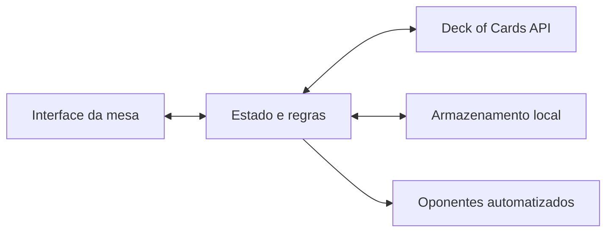

<div align="center">

# ♠ Clash Cards

### Oito Maluco, direto à mesa.

Um jogo de cartas para navegador: você enfrenta três oponentes controlados pelo computador, escolhe suas jogadas e tenta chegar a **100 pontos**.

**React 19 · TypeScript · TanStack Start · Deck of Cards API**

</div>

<br />

## Sobre o jogo

Clash Cards é uma partida de **Oito Maluco** para quatro participantes. A mesa, as mãos, o placar e o histórico são atualizados durante a partida; as cartas e os baralhos vêm da [Deck of Cards API](https://deckofcardsapi.com/).

| Na mesa | Como funciona |
| --- | --- |
| Participantes | Você e três oponentes automatizados |
| Mão inicial | 7 cartas para cada participante |
| Objetivo | Ser o primeiro a alcançar 100 pontos |
| Partida | Rodadas com pontuação acumulada |
| Salvamento | Automático no armazenamento local do navegador |

## Começar

### Requisitos

- Node.js e npm
- Conexão com a internet para buscar cartas na Deck of Cards API

### Instalação e execução

```bash
npm install
npm run dev
```

O terminal informa o endereço local do servidor de desenvolvimento. Abra-o no navegador para jogar. Não é necessário criar uma conta nem configurar uma chave de API.

### Outros comandos

| Comando | Para que serve |
| --- | --- |
| `npm run build` | Gera a versão de produção |
| `npm run typecheck` | Verifica os tipos TypeScript |
| `npm test` | Executa os testes automatizados do projeto |
| `npm run lint` | Analisa o código com ESLint |

## Regras

### Sua vez

1. Escolha uma carta válida na sua mão. As cartas que combinam com a mesa ficam destacadas.
2. Pressione **Confirmar jogada** para colocá-la no descarte.
3. Se não houver jogada possível, compre uma carta. Se ela puder ser usada, você pode confirmar a jogada; caso contrário, sua vez passa.
4. Os três oponentes jogam automaticamente.

Uma carta é válida quando combina com o **naipe atual** ou com o **valor da carta no topo do descarte**. O 8 pode ser jogado a qualquer momento e permite escolher o próximo naipe.

### Cartas especiais

| Carta | Efeito |
| --- | --- |
| **8** | Coringa: escolha Espadas, Copas, Ouros ou Paus. |
| **Ás** | Pula a vez do próximo participante. |
| **2** | O próximo compra duas cartas. Outro 2 pode rebater e acumular a compra. |

Quando há uma compra acumulada, apenas um **2** pode ser jogado para rebatê-la; sem um 2, é preciso comprar as cartas pendentes.

### Pontuação

Quando alguém fica sem cartas, essa pessoa vence a rodada e soma os pontos das cartas que restaram nas mãos dos adversários. As pontuações de rodadas empatadas não são adicionadas.

| Carta restante | Pontos |
| --- | ---: |
| 8 | 50 |
| 10, Valete, Dama ou Rei | 10 |
| Ás | 1 |
| Cartas numeradas de 2 a 9 | Valor da carta |

A partida termina quando alguém alcança **100 pontos**. Se ninguém conseguir jogar e o monte estiver esgotado, a rodada fica travada: vence a menor mão; se houver empate na menor pontuação, ninguém pontua.

## Controles

| Ação | Como fazer |
| --- | --- |
| Selecionar ou remover a seleção de uma carta | Clique ou toque na carta |
| Confirmar jogada | `Enter` ou botão **Confirmar jogada** |
| Percorrer cartas válidas | `←` e `→` |
| Comprar, quando permitido | `C` ou botão **Comprar** |
| Fechar uma janela | `Esc` |

Em telas sensíveis ao toque, os botões e as cartas também podem ser usados diretamente. O botão **Regras** abre o resumo dentro do jogo; **Jogadas** mostra o histórico da rodada.

## Como o projeto funciona



O estado e as regras do jogo são mantidos no navegador. A API fornece o baralho, as cartas compradas e as pilhas sincronizadas. O estado local guarda o identificador do baralho e o andamento da partida para que ela possa ser retomada.

### Organização dos arquivos

```text
src/
├── game/
│   ├── api.ts       Integração e operações com a Deck of Cards API
│   ├── main.ts      Ciclo da partida, turnos, ações e salvamento
│   ├── model.ts     Tipos, regras, pontuação, bots e estado persistido
│   ├── view.ts      Mesa, mãos, placar, diálogos e interações visuais
│   └── oito.css     Layout e estilos específicos do jogo
├── routes/
│   ├── __root.tsx   Estrutura compartilhada da aplicação
│   └── index.tsx    Página do jogo
├── components/     Componentes reutilizáveis
├── lib/            Integrações e utilitários compartilhados
├── router.tsx      Configuração do roteador
└── styles.css      Estilos globais
```

### Módulos do jogo

- **`model.ts`** concentra as regras: distribuição, jogadas válidas, efeitos das cartas especiais, pontuação, desempate, decisões dos bots e validação do estado salvo.
- **`api.ts`** encapsula os pedidos à Deck of Cards API e converte as respostas para os tipos usados pelo jogo.
- **`main.ts`** coordena as ações da pessoa jogadora, a sequência de turnos, as compras, a automação dos bots e a persistência.
- **`view.ts`** constrói e atualiza os elementos da mesa, apresenta regras e resultados, organiza o histórico e anima o movimento das cartas.
- **`oito.css`** define o layout responsivo da mesa e das mãos de cartas.

## Salvamento e conexão

- O progresso é salvo automaticamente no `localStorage` deste navegador e deste dispositivo; ele não é sincronizado entre dispositivos.
- Ao retornar, o jogo verifica se o baralho salvo ainda responde. Se ele tiver expirado ou estiver indisponível, um novo baralho é criado, mantendo a pontuação e a rodada salvas quando possível.
- Uma partida em andamento precisa de conexão com a Deck of Cards API para criar baralhos e comprar cartas. Falhas de conexão são apresentadas na mesa.
- **Novo jogo** inicia uma partida do zero e zera o placar.

## Tecnologias

| Tecnologia | Uso |
| --- | --- |
| React 19 | Página e montagem da experiência do jogo |
| TypeScript | Tipos do estado, das cartas e das ações |
| TanStack Start e Router | Aplicação e roteamento |
| Vite | Desenvolvimento e build |
| Deck of Cards API | Criação de baralhos e fornecimento de cartas |
| Web Audio API | Efeitos sonoros sintetizados no navegador |

## Licença

Consulte o arquivo [LICENSE](LICENSE) para os termos de uso e distribuição.
